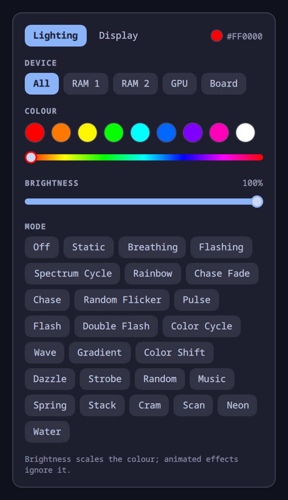
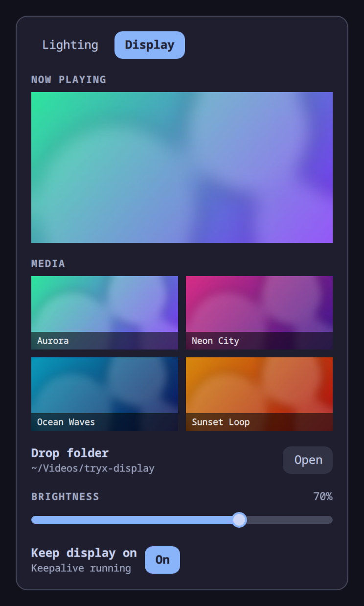

# RGB + Display Widget

A small control panel for **PC RGB lighting** and the **TRYX Panorama SE** AIO cooler display on Linux, written in
QML for [Quickshell](https://quickshell.org). Open it from a bar button, pick a colour or a mode, or tap a video to
play it on the cooler screen.

<p align="center">
  
  &nbsp;&nbsp;
  
</p>

> **Status:** works on the author's machine (see [Tested on](#tested-on)). It talks to hardware over USB, so treat it
> as beta software and read [Known limitations](#known-limitations).

## Features

**Lighting** (via [OpenRGB](https://openrgb.org))
- Control every OpenRGB device at once or one at a time: RAM, GPU, motherboard, and so on.
- Colour presets, a hue slider and a brightness slider.
- Mode buttons built from what each device actually supports, not a hard-coded list.
- Commands are queued, so dragging a slider never piles up requests.

**Display** (via [reed-tpse](https://github.com/fadli0029/reed-tpse))
- Thumbnail grid of the media on the cooler. Tap one to play it.
- Brightness slider and a "keep display on" switch for the keepalive service.
- **Drop folder:** drag videos, GIFs or images into `~/Videos/tryx-display/` and they appear in the widget on their own.
  Anything the panel can't play as-is is converted to a 2:1 H.264 MP4 first.
- Delete media from the cooler with a ✕ and a confirm step.

**Design**
- The UI is shell-agnostic QML. All theming is plain properties, so any shell can feed it colours and fonts.
- A ready-made adapter for the [Serpantinum](https://github.com/ilyamiro/serpantinum) Quickshell setup adds a bar button and a glass popout.

## Requirements

| What | Why |
|---|---|
| [Quickshell](https://quickshell.org) | runs the QML |
| [OpenRGB](https://openrgb.org) | lighting backend (with working udev rules and `i2c` access for RAM/GPU/board) |
| `adb` (android-tools), `ffmpeg`, `python3` | display media upload, conversion and thumbnails |
| `git`, `cmake`, a C++17 compiler | to build the patched reed-tpse |
| Membership of the `uucp` (Arch) or `dialout` (Debian/Ubuntu) group | the cooler's serial port, `/dev/ttyACM*` |

Arch example:
```sh
sudo pacman -S --needed quickshell openrgb android-tools ffmpeg cmake git
sudo usermod -aG uucp $USER     # then log out and back in
```

## Install

```sh
git clone https://github.com/<you>/rgb-display-widget
cd rgb-display-widget

./install.sh reed-tpse      # fetch upstream reed-tpse, apply patches/, build, install to ~/.local
./install.sh                # link rgb-ctl and tryx-ctl into ~/.local/bin and check dependencies
```

Try the panel in a standalone window:
```sh
quickshell -p qml/shell.qml
```

### Serpantinum bar button

```sh
./install.sh serpantinum --enable     # installs the button + popout and adds it to your bar
serpantinum reload
```
The installer backs up every file it changes, and can be re-run after a Serpantinum update.

### Other shells

Embed `qml/RgbDisplayWidget.qml` anywhere in your Quickshell config and feed it your theme:

```qml
RgbDisplayWidget {
    backendDir: "/home/me/.local/bin"   // folder containing rgb-ctl / tryx-ctl
    framed: false                       // let your popout draw the card
    shown: popout.visible               // pauses polling while hidden
    bg: theme.base; surface: theme.surface0; surfaceHi: theme.surface1
    fg: theme.text; subfg: theme.subtext; accent: theme.accent; accentText: theme.base
    fontFamily: theme.font; cornerRadius: 8; ui: 1.0     // ui = scale factor
}
```
Your shell's QML directory also needs a `qmldir` entry for the types if it uses explicit `qmldir` files
(the repo's `qml/qmldir` shows how).

## Usage from the command line

The backend scripts work without any UI:

```sh
rgb-ctl state                          # JSON: devices, their modes, current mode
rgb-ctl apply all Static FF8800 -      # DEVICE MODE COLOUR BRIGHTNESS ("-" = skip)
rgb-ctl apply 0,1 Rainbow - -          # comma lists work too

tryx-ctl state                         # JSON: media on the cooler, brightness, keepalive status
tryx-ctl display 70 2:1 my-video.mp4   # BRIGHTNESS RATIO FILE
tryx-ctl brightness 40
tryx-ctl sync                          # sync the drop folder now
tryx-ctl delete old-video.mp4
```

### Faster lighting (optional)

By default each lighting change starts a one-shot `openrgb` that re-probes your hardware (about 1.5 s).
For near-instant response run OpenRGB as a background server; the scripts use it automatically when it is listening:

```sh
cp systemd/openrgb-server.service ~/.config/systemd/user/
systemctl --user daemon-reload && systemctl --user enable --now openrgb-server
```

## The drop folder

Put files in `~/Videos/tryx-display/` (change it with `TRYX_MEDIA_DIR` or by writing a path into
`~/.config/rgb-display-widget/media-dir`).

- Videos, GIFs and images (`jpg png webp bmp`) are accepted. Anything that isn't already panel-safe MP4 is converted
  to 2160×1080 H.264 with black bars where the shape doesn't match. Images become 8 second clips.
- The widget syncs when it opens and every few seconds while the Display tab is visible.
- Deleting a file from the folder removes it from the cooler, but **only** files this tool uploaded. Media put there
  by other software is never touched.

## How it works

```
 Quickshell UI (qml/)  ──argv arrays, no shell──▶  backend/rgb-ctl   ──▶ openrgb (CLI / server)
                                                   backend/tryx-ctl  ──▶ reed-tpse ──▶ /dev/ttyACM* + adb
                                                   backend/tryx-sync ──▶ ffmpeg + adb (drop folder)
```

- The QML only ever launches the two `*-ctl` scripts with an argument array. User-supplied values are validated
  (device indexes, `RRGGBB` colours, mode names, plain file names) before anything runs.
- `reed-tpse` is [upstream](https://github.com/fadli0029/reed-tpse) plus two patches in `patches/`:
  1. hardens the `adb` calls. Upstream builds a shell command string, which makes file names a shell-injection risk. The patch
     uses `fork`/`execvp` and validates remote names.
  2. adds `--mode full|split`.
  `./install.sh reed-tpse` applies them to a pinned upstream commit.

## Known limitations

- **Split-screen layout does not work yet.** The panel's own app has a "Screen Splitting" mode, but its message
  format is unknown. Sending the obvious guesses gives a blank screen. See [docs/DEVELOPMENT.md](docs/DEVELOPMENT.md).
- **GIFs can't be played directly.** Raw `.gif` files on the cooler are shown greyed out. Put them in the drop folder so
  they are converted.
- Brightness on the Lighting tab scales the colour, because OpenRGB ignores its brightness flag on most devices. Animated
  effects ignore it.
- No file picker for uploads: use the drop folder.
- Lian Li wireless fans (SL V3 dongle) are not supported by OpenRGB and are out of scope.
- The panel reverts to its default screen after about a minute unless the keepalive service runs ("Keep display on").

## Troubleshooting

| Symptom | Cause and fix |
|---|---|
| `No device found` | The keepalive service holds the serial port, which breaks auto-detect. `tryx-ctl` always passes `-p` for you. If you use `reed-tpse` directly, add `-p /dev/ttyACM0`. |
| Permission denied on `/dev/ttyACM0` | Join the `uucp`/`dialout` group and log out and in again. |
| `reed-tpse: Is a directory` | A host launched the script with a `PATH` lacking `~/.local/bin`. Current versions export it themselves. Update. |
| Display goes blank after choosing a media file | The file isn't on the cooler (e.g. a GIF that was never converted). Use the drop folder. |
| An OpenRGB device is missing | Not a widget issue. Check OpenRGB itself: `openrgb --list-devices`, udev rules and your `i2c` group. |

## Tested on

- Arch Linux, Hyprland, Quickshell; Serpantinum shell
- TRYX Panorama SE (firmware V1.0.3, hardware V1.1)
- OpenRGB 1.1 with ENE DRAM, a Gigabyte RGB Fusion 2 GPU and an ASRock Polychrome motherboard

Other combinations are likely to work but have not been tested. Reports and pull requests are welcome.

## Credits and disclaimer

- Display protocol work: [reed-tpse](https://github.com/fadli0029/reed-tpse) by fadli0029 (MIT).
- Lighting: [OpenRGB](https://openrgb.org).
- This project is **not affiliated with or endorsed by TRYX**. The cooler's protocol is reverse-engineered; use at your own risk.
